# Star Tracker Report

**2026-11-14** | Total: **17 stars** | Change: **0**

> Compared to snapshot from 2026-11-13

## 📈 Star Trend


### By Repository

Individual Repository Charts

#### Adobiz/Pi-Drive-Hub: 8 ★ (0)


#### Adobiz/VibeKeys: 3 ★ (0)


#### Adobiz/DitingVeritas: 2 ★ (0)


#### Adobiz/LoRA-MT: 1 ★ (0)


#### Adobiz/lossless-atlas: 1 ★ (0)


#### Adobiz/nano-cloud: 1 ★ (0)


#### Adobiz/obsidian-mistake-notebook: 1 ★ (0)


#### Adobiz/Adobiz: 0 ★ (0)


#### SugarCubeConference/CiGA2026GGJ: 0 ★ (0)


## Repositories

| Repositories | Stars | Change | Trend |
|:-----------|------:|-------:|:-----:|
| [Adobiz/Pi-Drive-Hub](https://github.com/Adobiz/Pi-Drive-Hub) | 8 | 0 | ➖ |
| [Adobiz/VibeKeys](https://github.com/Adobiz/VibeKeys) | 3 | 0 | ➖ |
| [Adobiz/DitingVeritas](https://github.com/Adobiz/DitingVeritas) | 2 | 0 | ➖ |
| [Adobiz/LoRA-MT](https://github.com/Adobiz/LoRA-MT) | 1 | 0 | ➖ |
| [Adobiz/lossless-atlas](https://github.com/Adobiz/lossless-atlas) | 1 | 0 | ➖ |
| [Adobiz/nano-cloud](https://github.com/Adobiz/nano-cloud) | 1 | 0 | ➖ |
| [Adobiz/obsidian-mistake-notebook](https://github.com/Adobiz/obsidian-mistake-notebook) | 1 | 0 | ➖ |
| [Adobiz/Adobiz](https://github.com/Adobiz/Adobiz) | 0 | 0 | ➖ |
| [SugarCubeConference/CiGA2026GGJ](https://github.com/SugarCubeConference/CiGA2026GGJ) | 0 | 0 | ➖ |

## Summary

- **Stars gained:** 0
- **Stars lost:** 0
- **Net change:** 0

## 🔮 Growth Forecast

**Aggregate Forecast**

| Method | Week 1 | Week 2 | Week 3 | Week 4 |
|:---|---:|---:|---:|---:|
| Linear Regression | 17 | 17 | 18 | 18 |
| Weighted Moving Average | 17 | 18 | 18 | 18 |


### By Repository

Adobiz/Pi-Drive-Hub

**Adobiz/Pi-Drive-Hub**

| Method | Week 1 | Week 2 | Week 3 | Week 4 |
|:---|---:|---:|---:|---:|
| Linear Regression | 8 | 8 | 9 | 9 |
| Weighted Moving Average | 8 | 9 | 9 | 9 |


Adobiz/VibeKeys

**Adobiz/VibeKeys**

| Method | Week 1 | Week 2 | Week 3 | Week 4 |
|:---|---:|---:|---:|---:|
| Linear Regression | 3 | 3 | 3 | 3 |
| Weighted Moving Average | 3 | 3 | 3 | 3 |

Adobiz/DitingVeritas

**Adobiz/DitingVeritas**

| Method | Week 1 | Week 2 | Week 3 | Week 4 |
|:---|---:|---:|---:|---:|
| Linear Regression | 2 | 2 | 2 | 2 |
| Weighted Moving Average | 2 | 2 | 2 | 2 |

Adobiz/LoRA-MT

**Adobiz/LoRA-MT**

| Method | Week 1 | Week 2 | Week 3 | Week 4 |
|:---|---:|---:|---:|---:|
| Linear Regression | 1 | 1 | 1 | 1 |
| Weighted Moving Average | 1 | 1 | 1 | 1 |

Adobiz/lossless-atlas

**Adobiz/lossless-atlas**

| Method | Week 1 | Week 2 | Week 3 | Week 4 |
|:---|---:|---:|---:|---:|
| Linear Regression | 1 | 1 | 1 | 1 |
| Weighted Moving Average | 1 | 1 | 1 | 1 |

Adobiz/nano-cloud

**Adobiz/nano-cloud**

| Method | Week 1 | Week 2 | Week 3 | Week 4 |
|:---|---:|---:|---:|---:|
| Linear Regression | 1 | 1 | 1 | 1 |
| Weighted Moving Average | 1 | 1 | 1 | 1 |

Adobiz/obsidian-mistake-notebook

**Adobiz/obsidian-mistake-notebook**

| Method | Week 1 | Week 2 | Week 3 | Week 4 |
|:---|---:|---:|---:|---:|
| Linear Regression | 1 | 1 | 1 | 1 |
| Weighted Moving Average | 1 | 1 | 1 | 1 |

Adobiz/Adobiz

**Adobiz/Adobiz**

| Method | Week 1 | Week 2 | Week 3 | Week 4 |
|:---|---:|---:|---:|---:|
| Linear Regression | 0 | 0 | 0 | 0 |
| Weighted Moving Average | 0 | 0 | 0 | 0 |

SugarCubeConference/CiGA2026GGJ

**SugarCubeConference/CiGA2026GGJ**

| Method | Week 1 | Week 2 | Week 3 | Week 4 |
|:---|---:|---:|---:|---:|
| Linear Regression | 0 | 0 | 0 | 0 |
| Weighted Moving Average | 0 | 0 | 0 | 0 |

---
*Generated by [GitHub Star Tracker](https://github.com/fbuireu/github-star-tracker) on 2026-11-14T03:45:57.840Z*

*Made with 🤘 by [Ferran Buireu](https://github.com/fbuireu)*

